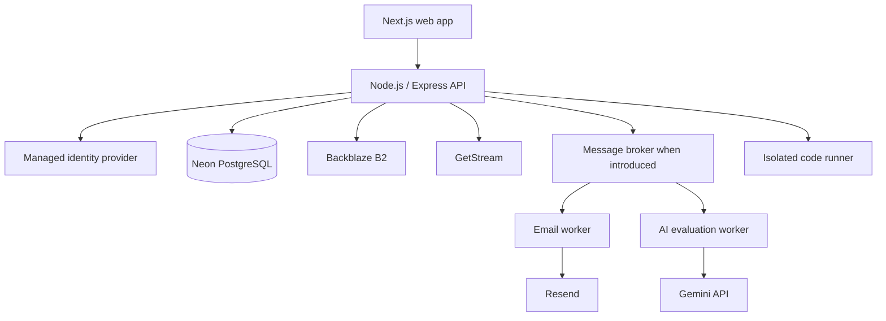

# Vettly System Design

**Status:** Initial architecture baseline  
**Audience:** Developers, reviewers, QA engineers, and AI coding agents  
**Last updated:** 2026-10-22

> This document defines intended architecture and engineering constraints. It does not prove that controls are implemented or that production SLOs have been met. Verify implementation with tests, security review, load tests, and operational evidence.

## 1. Purpose and principles

Vettly is a multi-tenant interview and assessment platform for organizations. Core capabilities include interview creation and invitations, coding/MCQ/written assessments, scheduling, managed video interviews, configurable proctoring signals, rubric-based AI-assisted evaluation, evidence-linked reports, candidate comparison, and organization administration.

Priorities: (1) protect candidate and organization data; (2) preserve confirmed assessment work; (3) keep APIs responsive and failures contained; (4) make the product accessible and intuitive; (5) maintain testable code; (6) scale based on measurements. Never claim Instagram-scale capacity or 99.99% availability without appropriate infrastructure, SLOs, load tests, monitoring, and recovery evidence.

## 2. Architecture

Use a monorepo with independently deployable runtime components. Separate services where independent scaling, security isolation, or failure containment justifies the operational cost. Do not split every domain into a network service by default.



- **Web:** Next.js; Vercel is the initial hosting preference.
- **Main API:** Node.js + Express; owns business rules and synchronous workflows.
- **Identity:** Managed provider initially; Supabase Auth is a candidate. The API independently verifies identity and enforces authorization.
- **Database:** Neon PostgreSQL is preferred; PostgreSQL is the source of truth.
- **Files:** Backblaze B2 for private resumes and attachments. Use Cloudinary only where image transformation is valuable.
- **Email worker:** Separate deployable process for templates, transactional delivery, retries, and delivery state; Resend is the initial provider candidate.
- **AI worker:** Separate deployable process for Gemini requests, rubric evaluation, and report generation.
- **Code runner:** Isolated execution environment for untrusted candidate code. Never execute candidate code in the API process.
- **Video:** GetStream handles media infrastructure; Vettly owns interview metadata, scheduling, permissions, and integration.
- **Queue:** RabbitMQ when asynchronous workload and operational readiness justify it. Do not make core operations depend on an undeployed/unmonitored queue.
- **Cache:** Redis only for measured caching, rate limiting, or short-lived coordination—not as source of truth.
- **Operations:** Structured logs, metrics, traces, error tracking, actionable alerts, audit events, backups, and restore tests are required before production.

Choose API hosting and regions based on measured latency, provider limits, recovery capabilities, and cost. Keep API and database in nearby compatible regions. Free-tier quotas are not production availability guarantees.

## 3. Repository layout

The current root layout is `backend/`, `frontend/`, `docs/`, and `infrastructure/`. Clarify the purpose of existing `frontend/app` and `frontend/web`; the Next.js `app/` directory should be inside the actual web app root.

Suggested target layout, to grow incrementally:

```text
Vettly/
├── backend/
│   ├── api/src/
│   │   ├── config/ middleware/ integrations/
│   │   ├── modules/
│   │   │   ├── organizations/ users/ admin/
│   │   │   ├── interviews/ assessments/ questions/
│   │   │   ├── candidates/ submissions/ proctoring/
│   │   │   └── reports/ audit/
│   │   └── app.js server.js
│   ├── email-worker/
│   ├── ai-worker/
│   └── code-runner/
├── frontend/web/
│   ├── app/ components/ features/ lib/ hooks/
├── packages/
│   ├── validation/ shared/ config/
├── infrastructure/
│   ├── docker/ deployment/
└── docs/
    ├── PRD.md
    ├── SYSTEM_DESIGN.md
    ├── DATABASE_DESIGN.md
    └── SECURITY_AND_OPERATIONS.md
```

Do not create every folder or deploy every worker immediately. Add structure when implementing the relevant feature. Shared packages must not become a dumping ground for domain logic.

## 4. Domain boundaries

The API is a modular application. Each module should separate HTTP handlers, application/business logic, data access, validation, and tests as the codebase grows.

- **Organizations/users:** membership, roles, invitations, tenant configuration.
- **Admin:** privileged platform operations with explicit authorization and audit logs; not a separate backend initially.
- **Interviews:** lifecycle, scheduling, invitations, candidate access, interview configuration.
- **Assessments/questions:** versioned question sets, MCQ options, written questions, coding prompts, test-case metadata, rubrics.
- **Submissions:** answer/code state, autosave, finalization, idempotency.
- **Proctoring:** settings and timestamped events. Signals are not proof of misconduct.
- **Reports:** rubric scores, evidence references, reviewer decisions, visibility rules.
- **Audit:** security and administrative events with controlled access and retention.
- **Integrations:** narrow adapters for identity, database, storage, email, AI, video, queue, and cache.

Every data access path must preserve authorization. Avoid circular dependencies and cross-module data-layer calls that bypass policy checks.

## 5. Critical workflows

### Authenticated request
Validate request shape, size, and content type; authenticate and validate token issuer/audience/signature/expiry as appropriate; resolve organization membership; authorize the action and resource; execute bounded parameterized database work; return a documented response with request ID; record required audit events. Never log passwords, tokens, secrets, or unnecessary candidate data. Never trust client-supplied organization IDs, roles, scores, or ownership without checking trusted state.

### Invitation and email
Persist the invitation and a durable job/outbox record where loss after commit would be unacceptable. A worker sends using a versioned template and provider adapter, records attempt/status, retries transient failures with exponential backoff and jitter, and sends repeatedly failing jobs to a dead-letter path with alerts. Use idempotent consumers and deduplication: queues do not guarantee exactly-once delivery. Separate transactional mail from promotional campaigns; implement consent, unsubscribe, and suppression handling as applicable.

### Assessment and recovery
Use server-authoritative state and deadlines. Autosave at sensible intervals with payload/rate limits; acknowledge only after persistence. Use idempotency keys or version checks for retryable writes. Final submission is a durable explicit transition. Resume from the last confirmed saved state after refresh or transient network failure. Define a grace policy for verified platform failures; do not pause timers for every client disconnect. Never silently discard confirmed work.

### AI evaluation
Create a durable job when an assessment is completed. Load only necessary authorized evidence and the exact rubric version. Send minimum necessary data under approved provider privacy settings. Validate output against a strict schema and allowed score ranges. Store provider/model and rubric/prompt versions, evidence references, output, status, and timestamps. Cap retries and expose failure state. Recruiters make final decisions; AI is advisory. Do not infer sensitive traits or treat proctoring signals as definitive cheating evidence.

### Code execution
Run submissions only in a hardened sandbox/container or equivalent isolation boundary. Apply strict CPU, memory, wall-clock, process, filesystem, and output limits. Deny network access by default; use non-root execution, read-only base filesystems, ephemeral workspaces, patched images, and no host/service secrets. Bound queue depth and concurrency. Treat the runner as a high-risk security boundary requiring dedicated tests and review.

## 6. API standards, pagination, and latency

Use versioned routes such as `/api/v1/...`. Publish an OpenAPI contract as endpoints mature. Standardize validation, error formats, status codes, authentication, and pagination.

Example list response:

```json
{
  "data": [],
  "page": { "nextCursor": null, "hasMore": false },
  "requestId": "opaque-request-id"
}
```

Example safe error:

```json
{
  "error": {
    "code": "VALIDATION_ERROR",
    "message": "The request is invalid.",
    "details": [],
    "requestId": "opaque-request-id"
  }
}
```

Never expose stack traces, SQL/provider errors, secrets, or sensitive internal details to clients.

### Pagination policy
All collection/list endpoints must be paginated by default; exceptions require a documented reason (e.g. a small, strictly bounded options list or a single-resource read).

- Prefer cursor/keyset pagination for large or frequently changing lists, with deterministic ordering and a unique tie-breaker.
- Offset pagination is acceptable for small collections or true page-number navigation, but must be bounded.
- Set a conservative default page size and hard maximum; handle invalid page inputs consistently.
- Never load an unbounded collection into application memory to paginate afterward.
- Bound request bodies, query complexity, export sizes, and response sizes; return only required fields.
- Enforce tenant scope in the data-access path, not merely as a UI filter.
- Test duplicate/skipped records under concurrent inserts/deletes and cross-tenant access.
- Use bounded async jobs or safe streaming for large exports.
- Pagination is not needed for single-resource reads or single-answer submissions.

### Reliability/performance
Set timeouts for requests, database operations, providers, and internal calls. Bound concurrency and connection pools. Retry only transient failures with exponential backoff, jitter, and an overall deadline; never blindly retry non-idempotent writes. Use idempotency keys for submissions, invitations, and other duplicate-sensitive operations. Add circuit breakers/bulkheads when they prevent a demonstrated cascade. Cache measured hot data with clear invalidation; never leak tenant data via shared cache keys. Avoid N+1 queries and index from observed query plans. Measure p50/p95/p99 latency, throughput, saturation, and error rates by endpoint. Load-test realistic traffic and bursts before defining SLOs.

## 7. Security and privacy

Use current OWASP ASVS and OWASP API Security Top 10 as verification references, adapted to Vettly's threat model. Security is a design and release requirement, not a later checklist.

### Identity and tenant isolation
- Use managed authentication initially; do not invent password storage or a custom identity protocol without strong reason.
- Enforce least privilege, organization membership, role checks, and resource-level authorization on every request, including reads.
- Separate platform-admin privileges from organization-admin privileges. Require MFA for privileged internal accounts where supported.
- Rate-limit login, verification, password reset, invitation, and other abuse-prone endpoints.
- Tenant-owned records need a clear organization ownership path. Derive organization context from verified membership, not client input alone.
- Apply tenant predicates to reads/writes, background jobs, caches, storage paths, and report access.
- Use database constraints and, where appropriate, PostgreSQL row-level security as defense in depth—not as a substitute for application authorization.
- Test cross-tenant IDOR/BOLA and privilege escalation for every resource family.
- Internal support access to candidate content is denied by default; exceptional access must be justified, authorized, time-limited, and audited.

### Application and infrastructure
- Validate all external input; use parameterized SQL and safe output encoding.
- Apply CSRF protection for cookie-authenticated state-changing requests; configure CORS narrowly.
- Use TLS, secure cookies, suitable security headers, and an appropriate Content Security Policy.
- Keep secrets in deployment secret management, never source control or client bundles; rotate exposed credentials.
- Lock and scan dependencies; scan secrets; update dependencies deliberately.
- Use least-privilege database and service credentials; separate production from development.
- Secure uploads with size/type limits, generated object keys, private storage, and malware scanning where warranted. Never trust filenames or declared MIME types.
- Issue short-lived presigned URLs only after authorization checks.
- Encrypt in transit and use managed encryption at rest where available.
- Redact credentials, tokens, and unnecessary personal data from logs/traces.
- Audit sensitive administrative actions and access to candidate records.
- Apply resource limits to expensive endpoints and external provider calls.
- Define incident response: detect, triage, contain, revoke compromised sessions/credentials, preserve evidence, assess impact, recover, notify as legally required, and conduct a blameless review.

### Candidate privacy and fairness
- Collect only data necessary for the stated purpose.
- Define retention/deletion rules for resumes, attachments, code, recordings, proctoring events, reports, and logs. Validate durations against applicable laws and contracts.
- Support legally required deletion/export and consider backups and downstream providers.
- Explain proctoring to candidates and record required notices/consent.
- Treat face/gaze/tab-switch/copy-paste events as imperfect signals, not proof.
- Restrict recordings and reports to authorized users; log sensitive access.
- Use explicit rubrics and evidence-linked AI outputs; retain relevant versions to investigate outcomes.
- Provide human review/correction. Never make hiring decisions solely from model output.
- Verify provider data-retention and model-training terms before sending candidate data to AI/video providers.

## 8. Data and provider decisions

### PostgreSQL / Neon
PostgreSQL is preferred over MongoDB because Vettly has relational entities and invariants (organizations, memberships, interviews, candidates, attempts, submissions, rubrics, evaluations, audit events). Foreign keys, transactions, constraints, and mature querying support consistency. Use JSONB for genuinely flexible configuration, not as a replacement for relational modeling. Neon is the current preference; Supabase is valid if bundled facilities materially simplify delivery. Compare region, measured latency, connection behavior, backups/recovery, limits, and production suitability—not storage quota alone. Version schema migrations and review them. Exact schema belongs in `DATABASE_DESIGN.md`.

### Backblaze B2
Keep objects private and store ownership/metadata in PostgreSQL. Use direct uploads with short-lived presigned URLs where supported. Verify object ownership before issuing downloads. Do not route large files through Express or store video binaries in PostgreSQL. Define lifecycle/retention and test deletion. Use Cloudinary only when transformations justify another provider. Verify region, egress, limits, and recovery before production.

### Redis, RabbitMQ, email, AI
Redis is optional acceleration/coordination, never authoritative storage for critical assessment state. Introduce RabbitMQ when workload and operations are ready; define acknowledgement, retry limits, dead-letter handling, idempotency, and backlog alerts. Do not add Kafka unless replay/streaming requirements justify it. Resend is the email provider candidate; isolate sending in a worker. Gemini is the initial AI provider; encapsulate calls in a small module, not an elaborate multi-provider abstraction. Verify provider quotas, privacy terms, and production limits at launch.

## 9. Frontend and UX

Use Next.js with feature-oriented code and shared design primitives. Do not introduce micro-frontends initially: they add deployment, versioning, routing, and consistency costs without a demonstrated team/scale need.

- Separate server/client responsibilities; never ship secrets to the browser.
- Use typed API contracts and shared validation where practical without coupling layers unnecessarily.
- Provide consistent loading, empty, success, error, retry, and offline states.
- Design keyboard navigation, focus management, labels, contrast, and screen-reader behavior.
- Optimize images, bundles, rendering, data fetching, and caching; measure Core Web Vitals.
- Use optimistic UI only when rollback/reconciliation is safe. Distinguish local edits from server-confirmed saves.
- Test responsive layouts and key flows on mobile, desktop, and slower connections.
- Hide private reports, proctoring data, and admin controls from unauthorized roles in both UI and API.

## 10. Observability, operations, and recovery

Before production, implement:
- Structured logs with correlation IDs and sensitive-data redaction.
- Metrics for request rate, errors, p50/p95/p99 latency, CPU/memory, DB pool saturation, queue depth/age, worker failures, provider errors, and runner utilization.
- Distributed traces across API, queues, and workers where practical.
- Actionable alerts with ownership and thresholds.
- Liveness/readiness checks.
- Managed database backups plus documented recovery point/time objectives and a tested restore.
- Rollback procedures and migration strategies compatible with rolling releases.
- Runbooks for DB/provider outage, queue backlog, email/AI failure, runner compromise, data exposure, and credential compromise.
- Capacity/cost monitoring and provider quota alerts.
- Incident process: detect, triage, contain, preserve evidence, assess impact, recover, notify as legally required, and review.

Do not claim 99.99% availability until vendor SLAs, redundancy, on-call response, and recovery design support it. Free tiers do not guarantee production availability.

## 11. Testing and release gates

Tests are executable evidence, not just documentation.

- **Unit:** domain rules, validation, scoring, authorization helpers, state transitions.
- **Integration:** DB constraints/migrations, queue behavior, provider adapters, transactional workflows.
- **API/contract:** schemas, errors, auth, authorization, pagination.
- **End-to-end:** organization setup → invite → assessment → save/resume → submit → evaluate → review.
- **Security:** tenant isolation, IDOR/BOLA, privilege escalation, injection, rate limits, sessions, upload abuse, secret/dependency scans.
- **Reliability:** provider timeouts, retries, duplicate jobs, queue outages, DB interruption, process restarts.
- **Performance:** realistic load, bursts, large collections, slow queries, queue saturation, runner concurrency.
- **Accessibility/usability:** keyboard-only flows, focus, labels, contrast, responsive layouts, error recovery.

Do not merge/deploy changes that fail relevant tests, lint/type checks, secret scanning, or required security checks. Review schema migrations and rollback compatibility. High-risk changes (auth, tenant access, uploads, proctoring, AI reports, code execution) require focused review. Production deploys should be staged and observable with rollback available.

## 12. Service evolution

Deploy API and workers independently where useful, initially from one repository. Extract a domain only when there is a measurable reason: independent scaling, untrusted/expensive workload isolation, different release needs, or reliability containment.

For every service document responsibility/owner, API/event contract and version, service authentication, timeouts/retries/idempotency, data ownership, metrics/alerts/runbooks, scaling, and rollback. Avoid shared writable tables across independently deployed services. The main API initially owns core business data; workers receive job identifiers and access only minimum necessary data with explicit credentials. Micro-frontends are not in the initial architecture; reconsider only if independent teams/releases and clear boundaries justify them.

## 13. Decisions and reconsideration triggers

| Area | Current choice | Rationale | Reconsider when |
|---|---|---|---|
| Frontend | Next.js | Routing, rendering, ecosystem | Measured needs/team constraints favor another framework |
| API | Node.js + Express | Familiar, effective for I/O-heavy workloads | Profiling identifies a workload better served elsewhere |
| Data | PostgreSQL on Neon | Relational integrity, transactions, JSONB | Region, limits, recovery, latency, or operations require migration |
| Files | Backblaze B2 | Object storage and cost-conscious start | Egress, CDN, region, access or lifecycle needs change |
| Email | Resend + worker | Avoid operating a mail server; isolate retries | Deliverability, compliance, limits, or scale require change |
| AI | Gemini + worker | Initial provider and asynchronous isolation | Quality, privacy, latency, cost, or availability fails requirements |
| Video | GetStream | Avoid building media infrastructure | Product/provider requirements or economics change |
| Queue | RabbitMQ when ready | Buffering and asynchronous retries | Replay/streaming needs justify another system |
| Cache | Redis when measured | Caching/rate limiting/coordination | Measurements show it is unnecessary or another option fits |
| Auth | Managed provider; Supabase Auth candidate | Reduce custom security burden | SSO, compliance, identity lifecycle, or cost requires change |
| Architecture | Modular API + isolated workers | Balance delivery and fault isolation | Independent scaling/ownership justify more services |
| Frontend boundaries | Single Next.js app | Avoid premature micro-frontend overhead | Independent teams/releases justify splitting |

Revalidate provider pricing, free-tier terms, privacy, and production suitability before launch.

## 14. Implementation sequence

1. **Foundation:** repo conventions, environment handling, CI, lint/type checks, tests, logs/request IDs, error format, validation, auth integration, authorization patterns.
2. **Tenant-safe core:** organizations, memberships, roles, migrations, audit events, pagination convention, secure CRUD.
3. **Assessment workflow:** interviews, versioned questions/rubrics, invitations, candidate access, autosave, submission, recovery.
4. **Secure execution:** sandbox, resource limits, test cases, concurrency policy, hostile-input tests.
5. **Communication/video:** email worker/provider, reminders, GetStream integration, permission checks.
6. **Evaluation/reports:** AI worker, strict schemas, evidence, versioning, human review, retries/failure states.
7. **Production readiness:** retention/deletion, backup restore test, security review, load test, alerting, runbooks, staged deployment, incident exercises.

Ship only the necessary structure at each phase. Do not build empty services merely because they appear in the diagram.

## 15. Instructions for AI coding agents and reviewers

Codex, Claude Code, Antigravity, and other agents must follow these rules:

1. Read this document and relevant PRD/database design before architectural changes.
2. Inspect current code/tests first; do not assume the proposed tree already exists.
3. Implement the smallest complete change consistent with architecture; avoid unrelated refactors and unjustified dependencies.
4. Never weaken authentication, tenant isolation, validation, auditability, or tests to make a test pass.
5. Never execute candidate code in the API process or grant it network, secret, or host access.
6. Paginate and bound all collection endpoints unless a reviewed exception is documented.
7. Enforce server-side authorization on every resource access, including tenant scope.
8. For async jobs define idempotency, retry limits, terminal failure behavior, and observability.
9. Add tests for normal cases, edge cases, authorization failures, concurrency, and relevant failures.
10. Run available tests, lint, type checks, and security checks; report exact commands/results. Never claim an unrun check passed.
11. Never hardcode secrets or expose private values in client bundles, logs, errors, or committed fixtures.
12. Update docs when API contracts, data models, service boundaries, controls, or operations change.
13. If a requirement is ambiguous or conflicts with this design, explain the conflict and propose the safest minimal resolution before major changes.
14. Explain important trade-offs and rejected alternatives in the change summary.
15. Treat this document as intended design, not proof of implementation; identify gaps between code and design.

## 16. Definition of production readiness

Vettly is not production-ready just because the happy path works. Evidence must show:
- Tenant and role boundaries, including negative/cross-tenant cases, are tested.
- Candidate code runs inside a tested isolation boundary.
- Confirmed submissions survive normal client/network interruptions.
- Sensitive access, retention, deletion, and audit behavior are defined and tested.
- APIs are bounded, paginated, timed out, and return safe errors.
- Async work handles retries, duplicates, dead letters, and backlogs.
- Backups restore successfully and deployments can roll back.
- Security, integration, end-to-end, accessibility, and realistic load tests have run.
- Monitoring and alerts detect user-visible failures.
- Provider limits/privacy terms and production plans have been reviewed.
- Customer-facing SLOs are supported by measurements and an operational plan.

## 17. Reference standards

Use current versions and adapt them to Vettly's threat model:

- OWASP ASVS: https://owasp.org/www-project-application-security-verification-standard/
- OWASP API Security Top 10: https://owasp.org/www-project-api-security/
- NIST Secure Software Development Framework: https://csrc.nist.gov/Projects/ssdf
- W3C WCAG 2.2: https://www.w3.org/TR/WCAG22/
- AWS Well-Architected Framework: https://aws.amazon.com/architecture/well-architected/

These references guide verification; they do not certify Vettly. Recheck standard versions and applicable legal requirements before launch.
